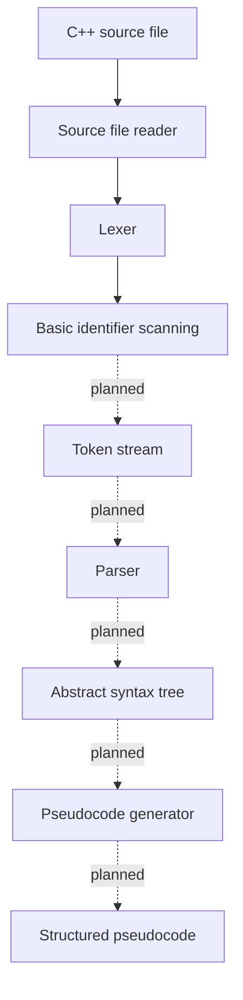
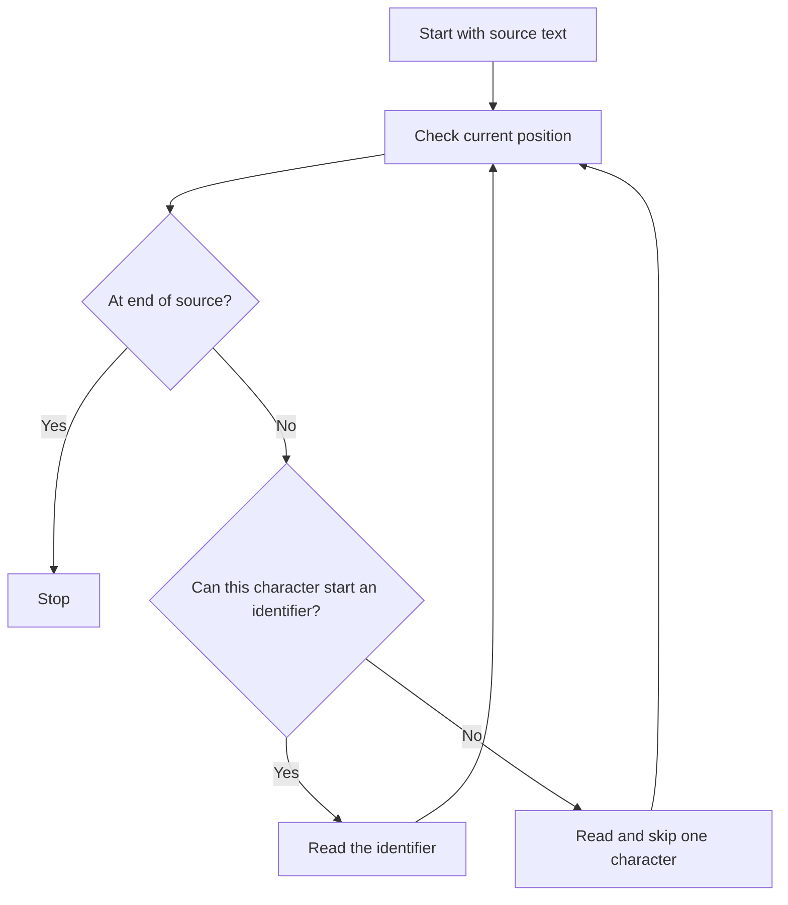
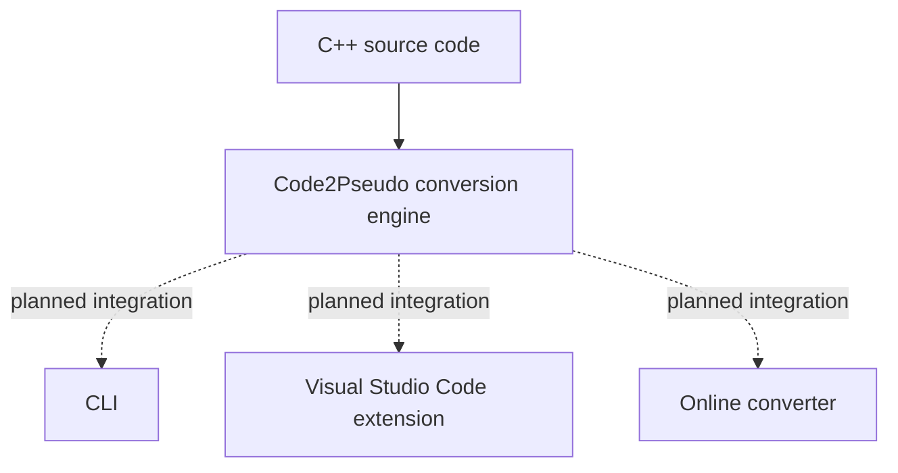

<!--
  Code2Pseudo README
  Keep the feature status and examples synchronized with the actual CLI.
-->

<div align="center">

# Code2Pseudo

### From C++ source code to clear, structured pseudocode.

**An educational compiler project built from scratch in C++20.**

<p>
  <a href="https://github.com/geniusinsanity/Code2Pseudo/stargazers">
    
  </a>
  <a href="https://github.com/geniusinsanity/Code2Pseudo/network/members">
    
  </a>
  <a href="https://github.com/geniusinsanity/Code2Pseudo/blob/main/LICENSE">
    
  </a>
  <a href="https://github.com/geniusinsanity/Code2Pseudo/commits/main">
    
  </a>
</p>

<p>
  
  
  
</p>

<p>
  <a href="#overview">Overview</a> ·
  <a href="#current-status">Status</a> ·
  <a href="#getting-started">Get started</a> ·
  <a href="#architecture">Architecture</a> ·
  <a href="#repository-structure">Repository structure</a> ·
  <a href="#roadmap">Roadmap</a> ·
  <a href="#contributing">Contributing</a>
</p>

</div>

---

## Overview

**Code2Pseudo** is an open-source project that aims to translate C++ source code into readable, structured pseudocode.

The goal is to make program logic easier to follow, discuss, and learn—without requiring readers to understand every detail of the original syntax.

The project is being developed from the ground up as a small compiler pipeline. It currently focuses on source-file handling and the first steps of lexical analysis. Parsing, syntax-tree construction, and pseudocode generation are planned stages, not completed features.

The long-term goal is to make the same conversion engine available through multiple interfaces:

- **CLI:** the first interface, used to develop and validate the compiler core.
- **Visual Studio Code extension:** a planned editor integration for converting code without leaving VS Code.
- **Online converter:** a planned web interface where users can submit C++ code and view the generated pseudocode.

These interfaces depend on a reliable conversion engine. The VS Code extension and online converter are future goals; neither is available yet.

> **Project status:** Early development. The current CLI is a development prototype, not yet a complete C++-to-pseudocode translator.

## Why Code2Pseudo?

- **Understand program logic:** the long-term goal is to express code as clear pseudocode.
- **Learn compiler construction:** the project is developed incrementally, from reading source files to lexical and syntax analysis.
- **Built from scratch:** the core is implemented in C++ rather than relying on an existing code-to-pseudocode service.
- **Open development:** the architecture and roadmap are visible so others can follow the progress and contribute.

## Current Status

The repository currently includes:

| Component | Status | Details |
|---|---|---|
| CMake project setup | Implemented | C++20 executable configured with CMake. |
| Source-file reader | Implemented | Reads a source file into memory using the C++ standard library. |
| Lexer cursor | Implemented | Tracks the current position and reads characters from the source. |
| Identifier scanning | Prototype | Recognizes identifier-shaped sequences. Keyword classification is not complete yet. |
| `Token` / `TokenType` definitions | Initial design | Data structures are present; a complete token stream is still in progress. |
| Parser and AST | Planned | Not implemented yet. |
| Pseudocode generation | Planned | The end-to-end translation is not available yet. |

## Current Prototype

At this stage, the CLI accepts a C++ file path, reads the file, displays its contents, and prints identifier-shaped words found by the lexer prototype.

### Example input

`examples/cpp/test.cpp`

```cpp
#include <iostream>

int main (void){
    int a =7;
    return a;
}
```

### Run

```bash
./build/code2pseudo examples/cpp/test.cpp
```

### What the current prototype prints

```text
Code2Pseudo Compiler
Input file: examples/cpp/test.cpp
file content:
#include <iostream>

int main (void){
    int a =7;
    return a;
}
All the idfs of this program are:
Word: include
Word: iostream
Word: int
Word: main
Word: void
Word: int
Word: a
Word: return
Word: a
```

This output demonstrates source loading and basic identifier scanning. It is **not** the final pseudocode output. In particular, keywords are still reported as identifier-shaped words in this prototype.

## Architecture

The intended processing pipeline is shown below. Solid arrows represent the current prototype path; dashed arrows represent planned stages.



### How the current lexer prototype scans input



## Repository Structure

The repository is organized into the compiler, language definitions, examples, documentation, and tests. The tree below follows the current workspace layout:

```text
Code2Pseudo/
├── build/                         # Local CMake build output (generated; do not commit)
├── compiler/
│   ├── app/
│   │   └── main.cpp               # CLI entry point
│   ├── core/
│   │   ├── AST/                   # Abstract syntax tree components
│   │   ├── errors/                # Compiler error types and reporting
│   │   └── source/
│   │       ├── sourceFile.cpp     # Source-file reading implementation
│   │       └── sourceFile.hpp     # SourceFile definition and declaration
│   ├── input/
│   │   ├── C/                     # C language frontend (planned / in progress)
│   │   └── cpp/
│   │       ├── lexer/
│   │       │   ├── lexer.cpp      # C++ lexical analysis implementation
│   │       │   ├── lexer.hpp      # Lexer interface and state
│   │       │   ├── token.hpp      # Token structure
│   │       │   └── tokenType.hpp  # Token type enumeration
│   │       └── parser/            # C++ parser (planned / in progress)
│   ├── output/
│   │   └── pseudocode/            # Pseudocode generation output stage
│   └── validation/                # Validation utilities
├── docs/                          # Project documentation
├── examples/
│   ├── cpp/
│   │   └── test.cpp               # C++ input example
│   └── expected/                  # Expected outputs for examples
├── language/
│   └── pseudocode/
│       ├── examples/              # Pseudocode examples
│       ├── grammar/               # Pseudocode grammar definitions
│       └── rules/                 # Pseudocode writing and formatting rules
├── output/                        # Generated output files
├── tests/
│   ├── integration/               # End-to-end pipeline tests
│   └── unit/                      # Isolated component tests
├── .gitignore
├── CMakeLists.txt                 # CMake project configuration
├── LICENSE
├── README.md
└── SECURITY.md
```

### What lives where?

| Path | Responsibility |
|---|---|
| `compiler/app/` | Command-line application entry point. |
| `compiler/core/` | Shared compiler components, including source handling, AST, and errors. |
| `compiler/input/cpp/lexer/` | C++ lexical analysis: character navigation, identifier scanning, and token definitions. |
| `compiler/input/cpp/parser/` | Reserved for parsing C++ tokens and building syntax structures. |
| `compiler/input/C/` | Reserved for a future C frontend. |
| `compiler/output/pseudocode/` | Pseudocode output stage. |
| `compiler/validation/` | Validation-related compiler components. |
| `language/pseudocode/` | Pseudocode examples, grammar, and language rules. |
| `examples/` | Sample input programs and expected outputs. |
| `tests/` | Unit and integration tests. |
| `docs/` | Additional project documentation. |
| `output/` | Generated files produced during local runs. |

> **Note:** `build/` is generated by CMake and should normally be ignored by Git. Empty placeholder directories may not appear in a GitHub checkout until they contain a tracked file (for example, a `.gitkeep`). The structure describes the current workspace organization; folders marked as planned or reserved are not claims of completed compiler functionality.

## Getting Started

### Requirements

- A C++20-compatible compiler (for example, GCC or Clang).
- CMake 3.20 or newer.
- Git.

### Build from source

```bash
# 1. Clone the repository
git clone https://github.com/geniusinsanity/Code2Pseudo.git

# 2. Enter the project directory
cd Code2Pseudo

# 3. Configure the build
cmake -S . -B build

# 4. Compile
cmake --build build
```

### Run

```bash
./build/code2pseudo examples/cpp/test.cpp
```

Pass one source-file path as the command-line argument. The current prototype reads the file and reports the identifier-shaped sequences it finds.

## Development Notes

Code2Pseudo is being built in small, understandable compiler stages:

1. Load the source file.
2. Track the current character in the input.
3. Recognize identifiers and other lexical elements.
4. Produce a stream of typed tokens.
5. Parse tokens into a syntax tree.
6. Generate structured pseudocode from the parsed representation.

The order matters: each stage provides the input needed by the next one.

## Planned Interfaces

Code2Pseudo is intended to grow beyond a command-line tool. The compiler core will be developed and tested first; additional interfaces can then reuse that core instead of implementing conversion logic separately.



| Interface | Goal | Status |
|---|---|---|
| CLI | Run conversions from the terminal and support development/testing. | Prototype in development |
| VS Code extension | Select or open C++ code in VS Code and request pseudocode from the Code2Pseudo engine. | Planned |
| Online converter | Paste or upload C++ code in a web interface and view the generated pseudocode. | Planned |

The exact integration design for the editor and web interfaces will be decided after the compiler core and CLI are stable.

## Roadmap

- [x] Initial CMake project and C++20 setup
- [x] Source-file loading
- [x] Lexer cursor and character-navigation helpers
- [x] Basic identifier scanning
- [ ] Keyword recognition
- [ ] Number scanning
- [ ] Operator and punctuation recognition
- [ ] Complete token generation
- [ ] Parser and abstract syntax tree (AST)
- [ ] Pseudocode generation for an initial C++ subset
- [ ] Stabilize the CLI and define a reusable conversion interface
- [ ] Build a Visual Studio Code extension powered by the Code2Pseudo engine
- [ ] Build an online C++-to-pseudocode converter
- [ ] Automated tests and broader examples
- [ ] Documentation of supported C++ syntax

Roadmap items may change as the architecture evolves. A checked item means the corresponding work is present in the repository; it does not imply full C++ language support.

## Contributing

Contributions, bug reports, and ideas are welcome.

- For bugs or feature ideas, [open an issue](https://github.com/geniusinsanity/Code2Pseudo/issues).
- For larger changes, open an issue first so the approach can be discussed before implementation.
- Keep pull requests focused and include a clear description of the change.
- Update examples or documentation when behavior changes.

Please read the [Security Policy](SECURITY.md) before reporting a potential vulnerability.

## License

Code2Pseudo is licensed under the [Apache License 2.0](LICENSE).

## Support the Project

If you find the project interesting, consider giving it a star on GitHub. Stars help other developers discover the repository and encourage continued development.

<p align="center">
  <a href="https://github.com/geniusinsanity/Code2Pseudo/stargazers">
    
  </a>
</p>

---

<div align="center">
  <sub>Built with C++20 · Developed in the open · More compiler stages coming soon</sub>
</div>
